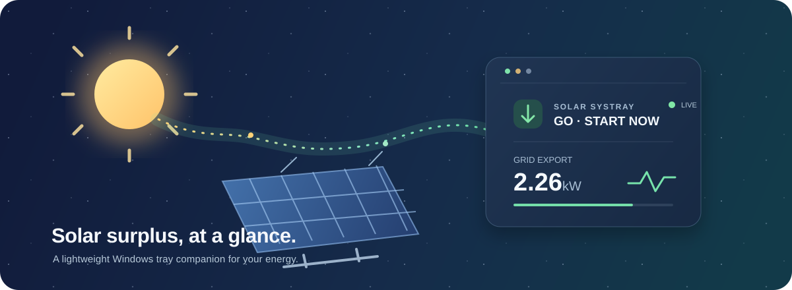

# Solar Systray



[](https://github.com/sujithq/solar-systray-rust/actions/workflows/ci.yml)
[](https://github.com/sujithq/solar-systray-rust/actions/workflows/release.yml)
[](https://github.com/sujithq/solar-systray-rust/actions/workflows/deploy.yml)

[](https://www.rust-lang.org/)
[](https://microsoft.github.io/windows-docs-rs/)
[](https://doc.rust-lang.org/cargo/)
[](https://serde.rs/)
[](LICENSE)

A minimal Windows notification-area (system tray) app that shows the same solar-surplus
information as [Solar Agent](https://github.com/madebyq/solar-agent): whether it is a good
moment to start a big appliance, what the grid is doing right now, and whether this
quarter-hour is about to set a new monthly peak. Everything is written in Rust.

It runs in the background as one small executable (about 1.1 MB) with no runtime to install.
Explicit Home Assistant mode uses HA WebSockets only. In legacy modes, when Solar Agent
is running it shows Solar Agent's data; otherwise it reads the meter itself, so Solar Agent
does not need to be running. See [Where the data comes from](#where-the-data-comes-from).

## What it shows

### Tray icon

Choose between two icon styles under **Icon style**:

| Level symbol (default) | Power in kW |
|---|---|
| Grey ⊘: no meter reading | `--` on grey |
| Indigo moon: night | |
| Red arrow: importing from the grid | Import in kW on red, for example `0.7` |
| Amber sun: producing, little or no surplus | Export in kW on the level colour, for example `4.2`; `10`–`99` above 9.9 kW |
| Light green sun: surplus | |
| Dark green sun: maximum surplus | |

On top of either style:

- **Green dot / bottom bar**: GO. Export has been stable above the selected appliance's
  start threshold for the configured time, so it is safe to start the appliance now.
- **Orange-red dot / top bar**: peak warning. The quarter-hour forecast will exceed this
  month's peak (or the 2.5 kW capacity-tariff minimum), or the peak has already been reached.

Hovering the icon shows a compact summary: the headline, the grid power (plus PV when an
inverter is configured), the appliance's start threshold, the quarter-hour forecast and today's
energy, for example `GO - START NOW` / `Export 2264 W | PV 3.1 kW`.

### Menu

Left- or right-click the icon:

- **Headline** with the reason, for example `GO IN 4:38` and `Stable for 0:23 of 5:00`.
- **Power now**: grid export and import; solar panels (PV), inverter output and household use
  when a Sungrow inverter is configured; and the night baseline learned from the meter.
- **Appliance**: pick the appliance to plan for; shows the export needed to start it.
- **Quarter-hour peak**: current demand, monthly peak, forecast, and how much import to cut.
- **Today**: energy imported and exported today, by the meter's clock.
- **Connections**: who reads the meter (`Solar Agent` or `Solar Systray`), sunrise and
  sunset, meter and inverter status.
- **Simulation** (when simulating): switch scenarios or set a grid power.
- **Icon style**, **Notifications**, **Start at sign-in**, **Open config file**,
  **Reload config** and **Quit**.

The open menu refreshes its displayed values every second; new Solar Agent snapshots arrive
every two seconds. You can leave the menu open to watch readings change without reopening it.
If a data-source or menu layout change occurs while the menu is open, close and reopen it to
see the new options.

### Notifications

Each can be switched off under **Notifications**, or all at once. They are standard Windows
notifications, so Do not disturb applies to them.

| Notification | When |
|---|---|
| GO gained | It became safe to start the selected appliance |
| GO lost | It is no longer safe |
| Peak forecast | This quarter-hour is on course to exceed the monthly peak; says how much import to cut and how long is left |
| Monthly peak | The quarter-hour demand reached this month's peak |
| Meter offline | No meter reading for `offlineNotifyAfterSeconds` (default 2 minutes), and again when it comes back |

When simulating, the titles start with `[SIM]`.

## Where the data comes from

**Explicit Home Assistant mode** (`solar.energySource.type: "home-assistant"`) is
independent of the legacy chooser described below. HA is the sole hardware reader;
the tray authenticates directly to HA's `/api/websocket` and runs its own existing
decision engine and appliance controls. It starts no Solar Agent client, meter
link or inverter poller, including after settings reload and during reconnects.
There is **no REST, Solar Agent API or direct-device fallback** when HA is unavailable.
Connections shows `Read by Home Assistant`, transport/initialization state,
per-entity evidence ages and sanitized failure codes.

The first implementation uses the standard WebSocket `subscribe_events`
(`state_changed`) command followed by WebSocket `get_states`. Subscribing before
the snapshot, buffering relevant events and discarding events older than that
snapshot avoids the initialization race. This deliberately uses full-state
messages rather than `subscribe_entities`' compressed deltas so timestamp and
unit validation use one representation. Commands, messages, initialization,
heartbeat responses and reconnect backoff are bounded. Each reconnect reauthenticates
and resubscribes; it discards eligible readings and resets GO stability.

### HA configuration and acceptance limits

Merge these sections into the `solar` object of your existing config:

```json
{
  "energySource": { "type": "home-assistant" },
  "homeAssistant": {
    "endpoint": "ws://127.0.0.1:8123/api/websocket",
    "tokenEnv": "SOLAR_HA_TOKEN",
    "atomicGrid": "sensor.dsmr_atomic_grid_sample",
    "gridImport": "sensor.electricity_meter_power_consumption",
    "gridExport": "sensor.electricity_meter_power_production",
    "activePower": "",
    "inverterStaleSeconds": 90,
    "gridSkewSeconds": 5
  },
  "decision": { "staleAfterSeconds": 30, "stableDurationSeconds": 300 }
}
```

`tokenEnv` names a process environment variable containing an **existing** HA token;
the credential itself is never written to the config, logs, diagnostics or error
messages. Provision it privately to the launched process using your credential
manager/launcher, not a source-controlled file or shared command. This change
does not create credentials or configure Windows to persist them.

The endpoint must use an IP literal and the exact `/api/websocket` path, without
credentials, queries or fragments. IP-only addressing avoids unbounded OS DNS
resolution; hostname URLs are not supported in this slice. Use `wss` with a
trusted certificate valid for that IP across untrusted networks. `ws` transmits
the token unencrypted and is appropriate only on a trusted local transport.
TLS validation is never disabled, and redirects are not followed.

#### Decision-grade atomic grid samples

`atomicGrid` selects one atomic DSMR sample entity **exclusively**. The example ID
is configurable: HA's registry may suffix it (for example
`sensor.dsmr_atomic_grid_sample_2`). Configure the actual publisher entity after
its separately approved setup; this client does not install a publisher. A missing,
invalid or unavailable atomic entity never falls back to the separate power
entities, REST, Solar Agent or hardware.

The acquisition-side publisher uses HA's existing complete, checksum-accepted
DSMR callback, not a second hardware reader. It must emit one entity update per
accepted telegram containing both validated powers, even when both are unchanged.
The numeric entity state is the positive integer `sample_sequence`. Its attributes
must contain:

| Attribute | Required contract |
| --- | --- |
| `schema_version` | Integer `1` |
| `session` | New random lifecycle identifier on publisher restart, 1-128 ASCII letters/digits/`-`/`_` |
| `sample_sequence` | Positive integer equal to state, at most 9007199254740991 |
| `meter_timestamp` | Timezone-aware UTC RFC 3339 meter message time |
| `received_at` | Timezone-aware UTC RFC 3339 acquisition callback arrival time |
| `import_w`, `export_w` | Same-telegram finite nonnegative powers, already **W**, at most 1000000 W |

The publisher reports `unavailable` on missing/invalid fields or acquisition
silence and omits powers rather than substituting zero. The client also rejects
an explicit false availability attribute if provided. It independently validates
schema, both powers, state/sequence agreement, UTC times, age **less than 30 s**
and future skew at most **5 s**. Future-tolerated samples are held unavailable
until both clocks are no longer in the future. An advancing sequence must also
advance meter time and callback time; arrival alone cannot conceal replay.

Atomic freshness uses the older of meter/callback time and a monotonic client
silence clock. `decision.staleAfterSeconds` may impose a stricter cutoff but cannot
weaken the publisher's 30-second bound. Every accepted new live sequence advances
the decision sample even when import is zero and export is constant. This permits
the unchanged surplus to earn the unchanged **300-second** sustained-GO requirement
without lengthening freshness or shortening stability.

Snapshots establish a replay watermark but never enable GO or renew sample age.
Reconnect requires a newer live sample and resets GO stability. A publisher session
change also resets GO; its sequence may restart, but its meter/callback times must
still advance. Replayed/nonadvancing sequences and retired sessions fail closed.
Retired-session tracking is bounded to 64 lifecycle changes in one client runtime;
overflow stays unavailable until a deliberate client restart. Diagnostics distinguish
atomic telegram evidence from provisional HA value-change evidence and expose the
sequence, meter/callback times and sample age separately from HA metadata.

**Publisher deployment and live acceptance are still pending.** Atomic client
support has been exercised with mocks only; measurement correctness remains the
user working assumption, not verified device behavior. Do not turn an advancing
built-in DSMR timestamp into a freshness signal: it can precede power updates or
come from a telegram missing required powers. Timestamp-only signals, arbitrary
debounce and heartbeat/report times do not establish an atomic sample.

#### Conservative separate-entity mode

For existing HA configurations, `atomicGrid` defaults to `""`, preserving the
previous conservative pair mode. This is an explicit configuration choice, not
an automatic recovery path from an unavailable atomic entity.
In this mode import/export are independently nonnegative **kW** values, multiplied by 1000
to watts; net import is import minus export. Both members must be valid and
independently younger than `decision.staleAfterSeconds` (default **30 s**), with
sample skew at most `gridSkewSeconds` (default **5 s**, configurable 0-30 s).
A coherent pair advances the decision sample only when a member has a newer
accepted value change, never from unrelated entities or display refreshes.
In either grid mode, optional `activePower` may map to `sensor.sg5_0rs_local_total_active_power` in **W**;
it expires independently after `inverterStaleSeconds` (default **90 s**).
Leaving it empty disables AC. Invalid/unavailable AC affects AC display only,
not otherwise valid grid decisions.

For the separate-entity mode, diagnostics label HA value-change times as provisional evidence, preserve HA
`last_changed`/`last_updated`/`last_reported` separately, and track receive age
with a monotonic clock. The snapshot alone cannot enable recommendations:
each required entity must supply new live value-change evidence after connection.
Equal numeric states, attribute-only updates, cached reconnect snapshots and
heartbeats retain the original evidence time and eventually expire. A steady
zero is not acquisition evidence. This is deliberately fail-safe: a sustained
zero import/export may prevent GO, and the default 300-second stability interval
cannot be earned from unchanged entities under the provisional 30-second limit.
Do not increase stale limits or shorten stability merely to hide this limitation;
use the approved atomic acquisition interface for unchanged-reading evidence
instead of using standalone meter clocks or unrelated report times.

Missing/removed entities, `unknown`, `unavailable`, malformed values/timestamps,
wrong units, negative grid power, future/out-of-order samples, stale data and
incoherent pairs clear recommendations. Transport/authentication failures clear
them immediately; recovery must earn a new stability interval. The existing
offline/recovery notification preferences remain available.

AC is not PV/DC. This slice does **not** map DC power, Sungrow yield counters,
connectivity or operating state, nor derive household use from unverified AC
topology/signs. Daily energy and quarter-hour demand/monthly-peak/forecast features
remain explicitly unavailable until full meter calendar/timezone fields, counters,
demand and peak mappings are established. No instantaneous-power or inverter-yield
approximation substitutes for them.

Live freshness UI validation failed previously; daytime PV/sign/topology checks
and real update cadence remain pending. This implementation and its synthetic
tests do not constitute device validation or authorize deployment/cutover.

### Opt-in monitoring acceptance harness

`cargo build -p solar-core --example ha_monitor` builds a bounded, monitoring-only
provider harness. It requires an existing token in the launched process's
`SOLAR_HA_TOKEN` and `SOLAR_HA_MONITOR_APPROVED=1`; never put a token in a command,
repository file or chat. A private local launcher can prompt with hidden input,
pass the credential process-locally and clear it afterward. This is not persistent
credential storage or a token-creation flow.

The harness uses only the loopback HA WebSocket and explicit atomic entity,
with direct readers disabled. It observes 310 seconds, stops only its own client
for a 31-second stale check, then starts a new client for 15 seconds to check
recovery/stability reset. It never changes HA, appliances or meter acquisition.
Output is a sanitized JSON report of durations/counts and safety outcomes, not
power readings, absolute timestamps, sessions, tokens or device identifiers.
It includes reconnect counts, allowlisted client-code/predicate polling histograms,
longest observed continuous fresh/candidate intervals and maximum engine stability.
`protocol_errors` is retained for old report readers but means aggregate client
errors, including validation failures; `client_errors` names it accurately.
Error deltas are attributed to the latest polled code, not an exact event log:
intermediate errors can be coalesced or superseded. Continuity is sampled every
200 ms and resets on gaps over 500 ms; it cannot prove unsampled transitions.
Acceptance requires at least 300 seconds of observed continuous freshness, not
merely 300 seconds between the first and last accepted samples.
Exit zero means these bounded acceptance checks passed; nonzero means incomplete
or failed acceptance. GO is not forced or required when existing predicates
(for example grid import) prevent it. Synthetic tests are not live acceptance.

### Legacy source selection

A SlimmeLezer does not reliably serve two clients: with two connections open, one of them
stops receiving telegrams. So the app prefers Solar Agent's status instead of keeping a
second meter connection open.

- **Solar Agent is running in solar mode**: the app reads Solar Agent's status from its local
  service every 2 seconds and opens no meter or inverter connection of its own. It finds the
  service through `%LOCALAPPDATA%\Solar Agent Data\settings.json`, which holds the port and
  the access token; set `SOLAR_AGENT_SETTINGS_INFO` to use another file. **Connections**
  shows `Read by Solar Agent`. Picking an appliance, a simulation scenario or a grid power
  changes it in Solar Agent, as if you had picked it there.
- **Otherwise**: the app connects to the SlimmeLezer and the inverter itself, using the `solar`
  settings in its own config file. **Connections** shows `Read by Solar Systray`.

When a poll detects Solar Agent, the app switches to its data and stops its own device
connections. A brief overlap is possible while a newly started agent is being detected;
this polling handoff is not a device lock.

The app switches back to its own connections after Solar Agent's settings info file has
been missing, its local port has been unreachable, or its mode has been `agents` (not solar)
for 10 seconds; until then the icon is grey. At startup, these conditions allow direct mode
immediately.

If Solar Agent accepts a connection but times out, rejects the token, or sends incomplete
or unreadable data, the icon turns grey and the menu shows `NO DATA FROM SOLAR AGENT` with
the reason. The app stays off the meter, because Solar Agent may still hold it. An unreadable
or invalid settings info file also keeps the app off the meter until corrected. Missing
solar readings alone do not trigger a competing connection.

The app only talks to Solar Agent on `127.0.0.1`, checks the size and format of every answer,
and never shows or stores the access token.

## Install and run

1. Download `solar-systray-X.Y.Z-windows-x64.zip` from the GitHub release page, or build it
   (see below). Copy `solar-systray.exe` to a permanent folder, for example
   `%LOCALAPPDATA%\Programs\Solar Systray\`. The executable is not code-signed, so Windows
   SmartScreen may warn the first time it runs.
2. Run `solar-systray.exe`. On Windows 11 the icon may start in the hidden-icons flyout (`^`);
   drag it onto the taskbar to keep it visible.
3. Optional: tick **Start at sign-in**. This adds a `Solar Systray` value under
   `HKCU\Software\Microsoft\Windows\CurrentVersion\Run` pointing at the current executable,
   so move the executable first.

Only one copy runs per signed-in session.

## Configuration

Settings live in `%LOCALAPPDATA%\Solar Systray\config.json`. On first run the app creates it:

- If Solar Agent's companion settings exist (`%LOCALAPPDATA%\Solar Agent Data\companion.json`),
  their meter, inverter, threshold, location and appliance settings are copied.
- Otherwise it starts in **simulation mode** with default settings, so you can try it out.

Edit the file with **Open config file**, then choose **Reload config**. If the file is
invalid, the icon turns grey with a warning dot and the menu shows the error.

```jsonc
{
  "solar": {
    // Use "slimmelezer" for a real meter (set host to its address), "mock" for simulation.
    "energySource": { "type": "slimmelezer", "host": "192.0.2.10", "port": 23, "allowLegacyWithoutCrc": false },
    // Optional Sungrow inverter over Modbus TCP; leave host empty to disable.
    "inverterSource": { "host": "", "port": 502, "unitId": 1 },
    "decision": { "safetyMarginW": 300, "stableDurationSeconds": 300, "importPeakW": 2500, "defaultAppliance": "dishwasher" },
    "location": { "latitude": 50.85, "longitude": 4.35 },
    "appliances": { "dishwasher": { "name": "Dishwasher", "peakW": 2000 } }
  },
  "tray": {
    "iconStyle": "level",          // or "power"
    "appliance": null,             // null uses decision.defaultAppliance
    "notifications": {
      "enabled": true,
      "goGained": true,
      "goLost": true,
      "peakForecast": true,
      "monthlyPeak": true,
      "meterOffline": true
    },
    "offlineNotifyAfterSeconds": 120
  }
}
```

The `solar` section uses the same format and validation as Solar Agent; the first run writes
it out in full with every setting. The `tray` section is written by the menu, so you rarely
need to edit it.

While the app shows Solar Agent's data, only the `tray` section applies, except
`tray.appliance`: the appliance is Solar Agent's.

When it reads the meter itself, the app is a read-only client:

- **SlimmeLezer / esp-link**: a TCP connection to the meter's telnet port (DSMR telegrams,
  CRC-checked). Do not also connect Solar Agent or Home Assistant to the same SlimmeLezer
  port; see [Where the data comes from](#where-the-data-comes-from).
- **Sungrow**: Modbus TCP reads for PV power, inverter output and household use.

## Build

Requires Windows, the Rust MSVC toolchain (1.88 or newer) and the Visual Studio Build Tools.

```powershell
cargo build --release
# target\release\solar-systray.exe
```

The build script embeds the executable icon and version information in plain Rust, so no
resource compiler is needed.

Run the checks that CI runs:

```powershell
cargo clippy --workspace --all-targets -- -D warnings -A clippy::approx_constant
cargo test --workspace
```

For an end-to-end check on an interactive Windows desktop with Explorer running, quit any
existing Solar Systray instance and run:

```powershell
cargo test --release -p solar-tray --test tray_smoke -- --ignored --nocapture --test-threads=1
```

This Rust test launches the actual executable with isolated temporary settings and loopback
Solar Agent, DSMR and Sungrow servers. It checks the registered shell icon, native menu values,
no direct device connections in agent mode (including an authentication failure), the fallback
grace period, direct readings, connection release when the agent returns, and clean exit.
It briefly opens menus, never uses your live devices or settings, and cleans up its own process
and temporary files. It is opt-in because it requires a desktop.

## Releases

Releases are made by GitHub Actions in two steps: **Prepare** builds everything and stores it,
then **Deploy** publishes it once someone approves. Add every user-visible change under
`## [Unreleased]` in `CHANGELOG.md`; those lines become the release notes.

1. Open **Actions → Release → Run workflow** on `main` and enter `patch`, `minor`, `major` or
   an exact version. The workspace already says 0.1.0, so enter `0.1.0` for the first release.
2. **Prepare** (Windows) bumps the version in `Cargo.toml` and `Cargo.lock`, and moves the
   Unreleased notes under a dated version heading. It then runs clippy and the tests, builds
   `solar-systray.exe`, and checks that the executable reports the new version. It packages
   `solar-systray-X.Y.Z-windows-x64.zip` (executable, README, LICENSE, CHANGELOG) and a
   `.sha256` file, then creates the `Release vX.Y.Z` commit and the `vX.Y.Z` tag without pushing
   them. Everything is kept as the run's `release` artifact. The run summary shows the release
   notes, the checksum and the full diff of the release commit.
3. **Deploy** waits for approval of the `release` environment. Once approved, it pushes the
   release commit and tag to `main` in one atomic, fast-forward-only push, then creates the
   GitHub release with the zip and its checksum. If `main` changed after Prepare, nothing is
   pushed or published; run Release again.

Prepare refuses a version lower than the current one, a version that is already tagged or
already has a changelog section, and an empty Unreleased section.

To see locally what Prepare would change, without committing or tagging:

```powershell
cargo xtask prepare patch    # or minor, major, 0.2.0
git diff
git restore CHANGELOG.md Cargo.toml Cargo.lock
```

One-time GitHub setup:

- Under **Settings → Environments**, create an environment named `release`. Add the people
  allowed to publish as **required reviewers**, and optionally allow deployments from `main`
  only. Deploy stops before pushing if this environment has no required reviewers, because
  GitHub would otherwise create the environment unprotected and skip the approval. Private
  repositories get required reviewers only on GitHub Enterprise; public repositories have
  them on every plan.
- The push to `main` uses the workflow's `GITHUB_TOKEN`. If `main` requires pull requests or
  status checks, the push is rejected and nothing is published. Releasing then needs a push
  identity that is allowed to bypass that rule.
- Pushes made by the workflow do not start the CI workflow. Prepare has already run the same
  checks on the release commit's contents.

## Layout

- `crates/solar-core`: a Rust port of Solar Agent's logic (DSMR parsing, surplus decision,
  quarter-hour peak forecast, daily energy, night baseline, sun times, simulation, SlimmeLezer
  and Sungrow clients), plus a client for Solar Agent's local status service. Shared JSON
  fixtures in `crates/solar-core/tests/fixtures` pin its behaviour to the original.
- `crates/solar-tray`: the Windows app (`solar-systray.exe`) built on the raw Win32 API
  through the [`windows`](https://crates.io/crates/windows) crate: tray icon, menu,
  notifications, settings and sign-in startup.
- `xtask`: release tooling run as `cargo xtask`. It bumps the version, dates the changelog and
  extracts release notes. It is not part of `cargo build`.
- `.github/workflows`: CI (`ci.yml`), plus Release (`release.yml`), which calls Deploy (`deploy.yml`).

## Credits and license

The logic in `solar-core` is ported from [madebyq/solar-agent](https://github.com/madebyq/solar-agent).
Released under the [MIT License](LICENSE), keeping Solar Agent's copyright notices.
